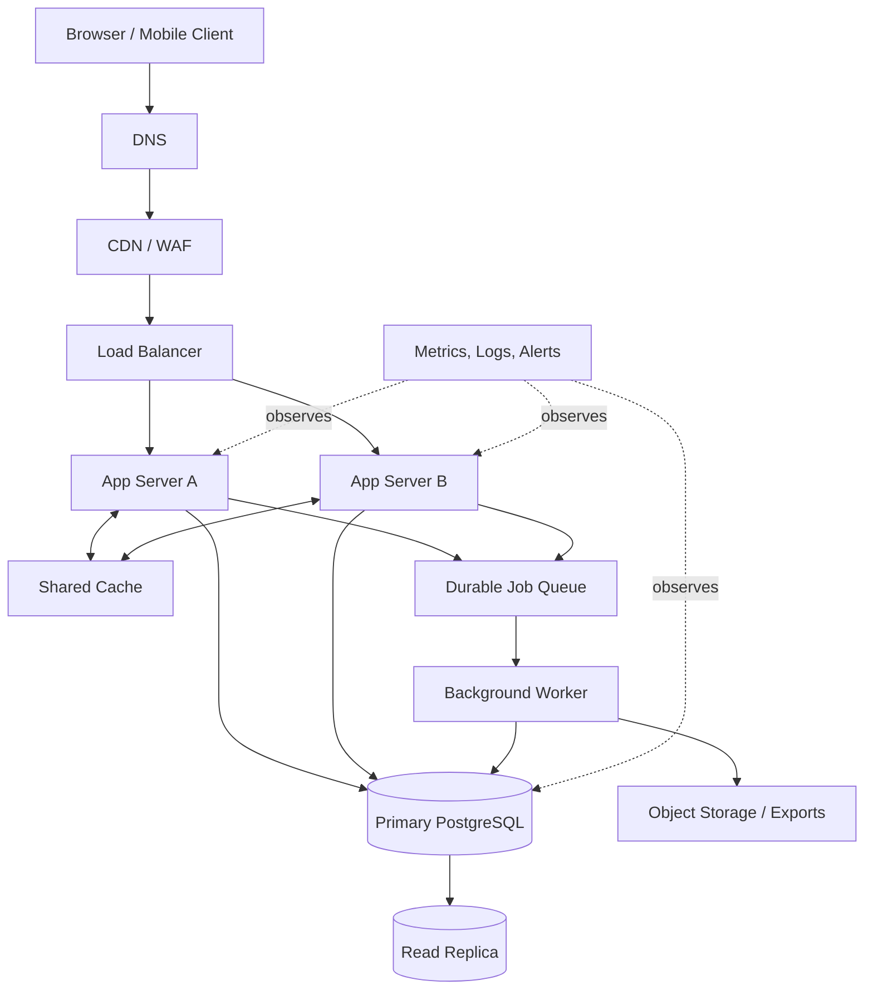

# QuickNotes Production Architecture

## Functional requirements

- Register, authenticate, and securely manage user sessions.
- Create, read, update, and delete a user's notes.
- Create tags and associate multiple tags with notes.
- Search/filter and paginate notes, with authorization enforced for every request.
- Provide predictable validation errors, account deletion, and data export.

## Non-functional requirements

- Availability target: 99.9% monthly as an initial service objective.
- Common note-list requests should have a target p95 latency below 300 ms under expected load.
- TLS in transit, encryption at rest, least-privilege access, and secure password hashing.
- Horizontal app-server scaling, observability, tested backups, and documented recovery procedures.
- Data isolation between users, graceful overload behavior, and accessible mobile-first clients.

## Capacity estimate for 1 million users

These are explicit planning assumptions, not measured production traffic:

- 1,000,000 registered users; assume 10% (100,000) active on a typical day.
- Each active user makes 40 read requests and 4 writes per day.
- Daily reads = 100,000 × 40 = 4,000,000; average reads/sec = 4,000,000 ÷ 86,400 ≈ **46 reads/sec**.
- Daily writes = 100,000 × 4 = 400,000; average writes/sec = 400,000 ÷ 86,400 ≈ **5 writes/sec**.
- For burst planning, provision initially for 10× average: about **460 reads/sec and 50 writes/sec**, then load-test and resize based on measured peaks.
- Storage assumption: each user stores 100 notes; each note averages 2 KB of text plus metadata/index overhead approximated at 1 KB. 100,000,000 notes × 3 KB ≈ 300 GB primary note data. Add roughly 20% for indexes/overhead and 1× logical data for a replica gives around **720 GB of primary-plus-replica capacity** before backups and growth. At 10% growth annually, budget approximately **330 GB/year of new primary logical note data** (100 million notes × 10% × 3 KB); actual storage depends strongly on adoption and note length. Images/attachments are excluded and should use object storage.

## Architecture diagram

## What each component solves

- **Client:** presents the note interface and sends authenticated HTTPS requests.
- **DNS:** resolves the public API hostname to the service entry point.
- **CDN/WAF:** caches safe static assets near users and filters common malicious traffic; private note API responses are not publicly cached.
- **Load balancer:** distributes requests, performs health checks, and stops routing to unhealthy app instances.
- **App Server A and B:** run stateless API logic so capacity can scale horizontally and one instance can fail without taking the service offline.
- **Shared cache:** reduces repeated database reads for suitable data; use short TTLs and invalidate or update cached data after writes.
- **Primary database:** owns authoritative writes and transactional consistency.
- **Read replica:** serves eligible read-heavy queries and reduces primary load, with awareness of replication lag.
- **Durable queue:** buffers retryable background work and decouples slow tasks from user-facing requests.
- **Worker:** processes exports, notifications, cleanup, or other asynchronous jobs with retries and idempotency.
- **Object storage:** holds generated exports or future attachments more cheaply than relational rows.
- **Metrics/logs/alerts:** reveal errors, latency, saturation, and failed jobs so operators can respond before a small issue becomes an outage.

## GET `/api/v1/notes` request flow

1. The client resolves the API hostname through DNS and sends an HTTPS request.
2. CDN/WAF applies security rules; personalized note responses bypass shared public caching.
3. The load balancer forwards the request to a healthy app server.
4. The app server validates the access token, parses pagination/filter parameters, and identifies the authenticated user.
5. The app checks the shared cache for a safe user-scoped cache key; on a miss, it queries the read replica if its freshness is acceptable, otherwise the primary.
6. The database applies `user_id` filtering, index-assisted ordering, and the page limit.
7. The app serializes the page and cursor, returns `200 OK`, and may cache the result briefly. Cache keys and invalidation must be scoped by user.

## POST `/api/v1/notes` request flow

1. The client sends JSON over HTTPS with a valid access token.
2. DNS, WAF, load balancer, and a healthy app server route the request as above.
3. The app authenticates the user and validates title length, body size, and permitted fields; the owner ID comes from the token, not client input.
4. The app starts a database transaction and inserts the note into the primary database.
5. The transaction commits; the app invalidates or updates affected user-scoped cache entries.
6. The app returns `201 Created` with the created note and its server-generated ID.
7. If follow-up work is needed (for example, an export or notification), the app publishes a durable job, ideally through a transactional outbox so a committed note is not lost if queue publication fails. The worker retries transient failures safely.

## Trade-offs and resilience

1. **Cache speed versus freshness:** caching lowers database load and latency but can return stale results. Use short TTLs, per-user keys, explicit invalidation after writes, and bypass the cache for operations requiring read-after-write consistency.
2. **Read replica scale versus consistency:** replicas offload reads but may lag behind the primary. Route writes and immediate read-after-write requests to the primary; monitor replication lag and fall back to primary if needed.
3. **Synchronous versus queued work:** queues keep slow tasks out of the request path but add eventual consistency and operational complexity. Keep core note creation synchronous, use durable queues for secondary tasks, and make jobs idempotent with bounded retries and a dead-letter queue.
4. **Managed services versus cost/control:** managed databases and queues reduce operational burden but cost more and can create provider dependency. Define recovery/export plans and avoid provider-specific coupling where practical.

## Avoiding single points of failure

Run at least two app instances across separate failure domains behind a health-checking load balancer; use redundant DNS/CDN edges; deploy the database with automated failover and tested backups; use a highly available managed cache and durable replicated queue; and monitor dependencies with alerts and recovery runbooks. A read replica alone is not a backup. Regularly test restore and failover procedures, and set explicit RPO/RTO objectives before production launch.
